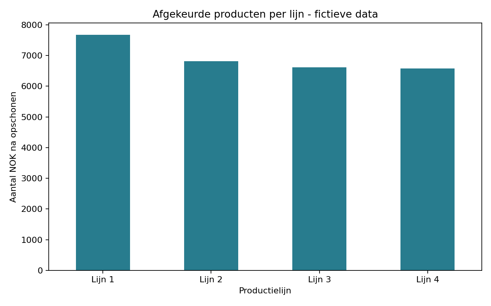

# CapsulaCo - productiegegevens analyseren met Python

Een oefenproject binnen Business IT & Management van Reda Azir. Dit project leest productiegegevens in, schoont ze op en maakt een grafiek en samenvatting per productielijn. Het is een analysescript, geen interactief dashboard.

## AI-gebruik en herkomst

De oorspronkelijke code is voornamelijk met AI gemaakt. Deze publiceerbare versie, de uitleg en de vervangende dataset zijn ook met hulp van AI voorbereid. Dit project is bedoeld om mee te oefenen en toont niet aan dat ik alle code zelfstandig heb geschreven. De oorspronkelijke dataset is niet meer beschikbaar.

**Alle meegeleverde gegevens zijn fictief en met AI gegenereerd voor demonstratiedoeleinden. Ze bevatten geen echte bedrijfsgegevens.** De resultaten hieronder zijn gemaakt bij het voorbereiden van dit pakket, niet door een nieuwe uitvoering van de student.

## Wat doet het script?

1. Leest een CSV-bestand met puntkomma's als scheidingsteken.
2. Maakt schrijfwijzen van lijnnamen gelijk.
3. Verwijdert rijen met ontbrekende waarden, uitschieters in `nok` met de IQR-methode en dubbele rijen.
4. Telt productie en afgekeurde producten per lijn op en berekent het NOK-percentage.
5. Slaat opgeschoonde data, een samenvatting en een staafdiagram op in `output`.

NOK betekent hier: afgekeurd product. De fictieve dataset bevat 122 rijen met vier productielijnen, inclusief twee duplicaten, een ontbrekende waarde, afwijkende lijnnamen en een hoge NOK-waarde om het opschonen te demonstreren. Na de huidige opschoonregels blijven 118 rijen over.

## Voorbeeldresultaat



## Uitvoeren op Windows

Installeer Python 3 en open een terminal in deze projectmap. Voer uit:

```bat
py -m pip install -r requirements.txt
py analyse.py
```

Op macOS/Linux kun je `python3` in plaats van `py` gebruiken. De uitvoermap wordt automatisch aangemaakt. De paden worden bepaald vanaf de locatie van het script.

## Bestanden

| Bestand | Inhoud |
| --- | --- |
| `analyse.py` | Python-analyse |
| `requirements.txt` | Benodigde Python-pakketten |
| `data/capsulaco_productie_groot.csv` | Fictieve invoergegevens |
| `output/productie_schoon.csv` | Opgeschoonde gegevens |
| `output/samenvatting_per_lijn.csv` | Productie, NOK en NOK-percentage per lijn |
| `output/capsulaco_nok_per_lijn.png` | Grafiek met de voorbeeldresultaten |

## Verschil met de oorspronkelijke schoolversie

De oorspronkelijke versie schreef naar MySQL en verving daarbij een bestaande tabel. Deze demonstratieversie slaat de resultaten alleen lokaal op als CSV en PNG. MySQL en databasewachtwoorden zijn niet nodig. Er is een samenvatting met NOK-percentages toegevoegd.

## Beperkingen

De IQR-filter wordt toegepast op absolute NOK-aantallen over alle lijnen. Een hoge waarde kan in echte data juist een belangrijk kwaliteitsprobleem aangeven; verwijder zulke waarden niet zonder onderzoek. De samenvatting beschrijft alleen de overgebleven rijen. De grafiek met aantallen is niet voldoende om lijnen eerlijk te vergelijken wanneer hun productievolume verschilt; bekijk daarvoor ook de percentages. Uit fictieve data kunnen geen conclusies over een echt bedrijf worden getrokken.

## Leerdoel

Leren uitleggen hoe CSV-invoer, opschonen, groeperen en visualiseren samenwerken. Dit sluit aan op mijn interesse in data-analyse en procesverbetering binnen een IT-team.
